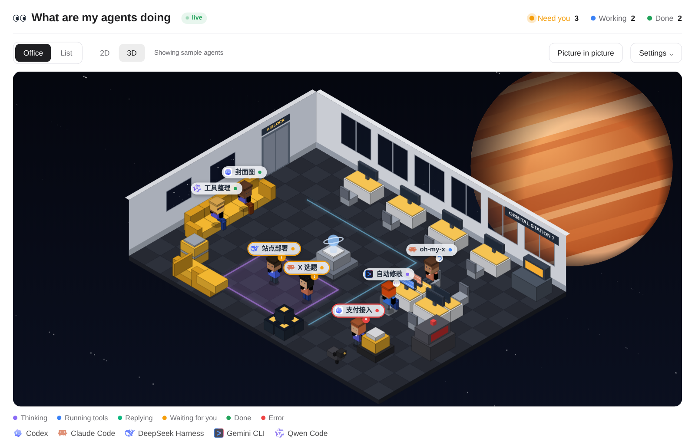
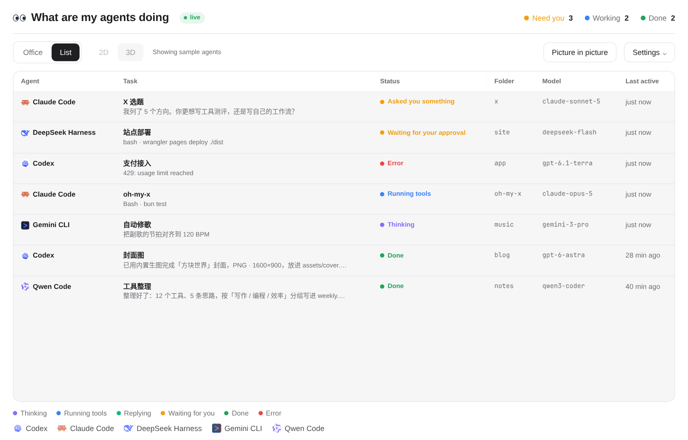
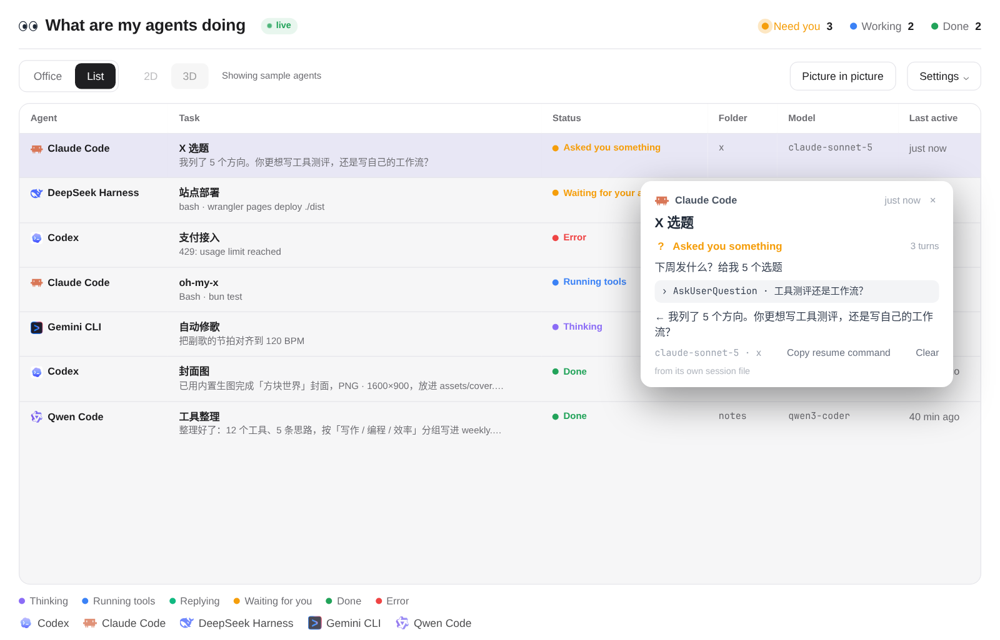
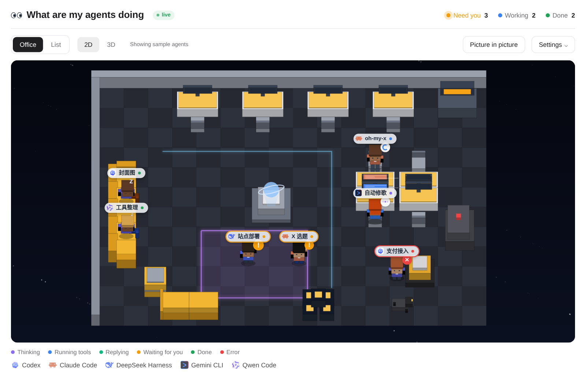

# Agent Office · 我的 Agent 在干嘛

**A live office view of the coding agents running on your machine, in a browser tab.**
Each session becomes a little worker in an isometric space station: thinking at a desk, running tools with its screen lit, waiting for your approval in the purple square, asleep on the sofa when done.



No API keys, no cloud, no telemetry. A small local service reads the session files each agent already writes to your disk, and the page draws what it finds.

This is the page of the [magpie](https://usemagpie.ai) plugin [`@magpie-community/page-agent-office`](https://github.com/magpie-community/plugins/tree/main/packages/agent-office), lifted out of magpie into one file plus a service: a static `index.html`, an 87-line `server.mjs`, and the plugin's own session readers.

## Quick start

```sh
git clone https://github.com/Dakai/agent-office-web
cd agent-office-web
node server.mjs          # node >= 22.15 (or bun)
```

Open **http://localhost:7317**. It shows the agents at work right now; with nothing running, an empty office.

No install needed to look at it: open `index.html` in a browser and it shows sample agents instead.

## Install as a service

```sh
./install.sh                # systemd user unit, enabled, starts at boot
PORT=8000 ./install.sh      # another port (rewrites the unit)
./install.sh --uninstall    # stop, disable, remove
```

`install.sh` writes `~/.config/systemd/user/agent-office.service` (`Restart=always`), enables it, starts it, and turns on `loginctl enable-linger` so it keeps running after you log out.

## Where it listens

| Address | |
|---|---|
| `http://localhost:7317` | always |
| `http://<tailnet-ip>:7317` | when tailscale is up — the address is found with `tailscale ip -4`, or set `TAILSCALE_IP` |
| `HOST=0.0.0.0` | replaces both: also reachable from the LAN |

Two listeners, deliberately: the tailnet is a private network, your LAN is not. The page carries prompts and folder paths, so nothing listens on `0.0.0.0` unless you ask. For HTTPS on the tailnet, `tailscale serve --bg http://127.0.0.1:7317` in front of it works.

## What it reads

Every 1.5 s, from the last two days, at most the 40 most recently changed files per agent — and only those whose size or mtime moved:

| Agent | File |
|---|---|
| Claude Code | `~/.claude/projects/*/*.jsonl` (+ `sessions/<pid>.json` for live processes) |
| Codex | `~/.codex/sessions/YYYY/MM/DD/rollout-*.jsonl` |
| DeepSeek Harness | `~/.dsh/sessions/*/*/session.v4.jsonl[.zstd]` |
| Gemini CLI · Qwen Code | `~/.gemini/tmp/*/chats/session-*`, `~/.qwen/tmp/*/chats/session-*` |
| Pi · omp | `~/.pi/agent/sessions/*/*.jsonl`, `~/.omp/agent/sessions/*/*.jsonl` |
| Qoder · WorkBuddy · CodeBuddy | their `projects/*/*.jsonl` |

The `CLAUDE_CONFIG_DIR` / `CODEX_HOME` / `DSH_HOME` / `PI_CODING_AGENT_DIR` / `QODER_CONFIG_DIR` / `QODERCN_CONFIG_DIR` / `WORKBUDDY_CONFIG_DIR` / `CODEBUDDY_CONFIG_DIR` variables are honoured. The file decides the status outright: a tool call with no result is **running**, an approval request is **waiting for you**, a question tool is **asked you something**, the turn's end is **done**, an interruption is **stopped**, an error turn is **error**; a turn whose file hasn't moved for 10 minutes is **stuck**. A Claude Code session with no living process is **stopped** at once.

Anything else — Cursor, OpenCode, Copilot, Kimi — does not appear: in magpie those are seen through its gateway, which does not exist here.

## The page

| | |
|---|---|
| **Office** | isometric 3D or top-down 2D; who needs you is in the purple square, done ones nap on the sofa |
| **List** | status, current step, folder, model, last activity |
| **Click** a worker, its tag or a row | task, last question, current step, the start of its answer, model, folder, resume command |
| **Picture in picture** | the office in a window of the page's own: drag the bar, resize the corner, ✕ or Esc puts it back |
| **Settings** | sample agents, show finished agents, leave the office after 1h/6h/24h/never, show prompts and replies |





## Privacy

- It **reads** the agents' session files and writes nothing: no database, no file in this folder, no network out.
- `live.js` (served, not written to disk) holds: agent, session id, folder name and path, model, the last prompt (200 chars), the first 280 chars of the last answer, and the names and targets of recent tool calls. No key, no header, no whole conversation.
- `AGENT_OFFICE_TEXT=0` cuts the prompts, replies, errors and command arguments at the source — statuses and tool names only.
- The page loads nothing from the internet: its icons are embedded, and it asks the service for no data beyond `live.js`.

## Options

| Environment | Default | |
|---|---|---|
| `PORT` | `7317` | |
| `HOST` | `127.0.0.1` + tailnet | where to listen |
| `TAILSCALE_IP` | autodetected | tailnet address to bind |
| `AGENT_OFFICE_TEXT` | `1` | `0`: statuses and tool names only |

The page's own settings (mode, dim, sample agents, show finished, hide-after, text) are kept in this browser's `localStorage`.

## Limitations

- Agents with no session file here and no magpie gateway in front of them are invisible.
- Not the model's word-by-word progress: a file is written per message, so "replying" means the file moved and the answer has begun.
- Sessions older than two days, or past the latest 40, are left out to keep each read cheap.

## Files

| | |
|---|---|
| `index.html` | the page, 423 KB, self-contained (CSS, scripts, 53 agent icons inline) |
| `server.mjs` | serves the page and `live.js`; rescans every 1.5 s |
| `lib/readers.mjs`, `lib/scan.mjs` | the plugin's readers, unchanged apart from zstd via `node:zlib` |
| `install.sh` | systemd user unit, `--uninstall` |
| `build.mjs` | rebuilds `index.html` from a `magpie-community/plugins` checkout — never hand-edit the output |
| `docs/` | screenshots |

## Rebuild from upstream

```sh
git clone --depth 1 https://github.com/magpie-community/plugins /tmp/ao
AO_COMMIT=$(git -C /tmp/ao rev-parse HEAD) \
  node build.mjs /tmp/ao/packages/agent-office index.html
```

`build.mjs` shims the magpie page API (language and theme from the system, options in `localStorage`), embeds the icons as data URIs, and moves the page's script to the end of `<body>`.

## Credits

- The page, its readers and simulator: [`QingJ01/magpie-agent-office`](https://github.com/QingJ01/magpie-agent-office) and [`magpie-community/plugins`](https://github.com/magpie-community/plugins/tree/main/packages/agent-office), MIT.
- Agent icons come from magpie's own assets, MIT.
- MIT. See [LICENSE](LICENSE).
